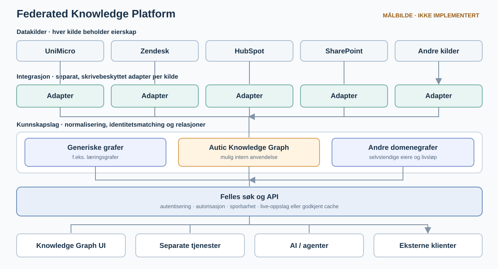

# Arkitekturoversikt: Federated Knowledge Platform

**Status:** Målbilde, ikke beskrivelse av en ferdig integrert plattform. [UniMicro-skissen](integrations/unimicro-integration.md) går dypere inn i én mulig integrasjon. [Arkitektur og dataflyt](architecture-data-flow.svg) viser dagens app og et eget, foreslått UniMicro-løp.

## Formål og det som finnes nå

Prosjektet er en lokal Flask- og Cytoscape-app for å utforske og redigere flere **uavhengige kunnskapsgrafer**. Hver graf ligger i en egen JSON-fil i `graphs/`, med et eget tilbakestillingsgrunnlag i `graph_starters/`. Appen tilbyr valg av graf, søk og navigasjon innen den valgte grafen, samt lokale endepunkter for lesing og redigering. Den offentlige GitHub Pages-demoen er en **statisk, skrivebeskyttet kopi av Autic Product Graph**, basert på manuelt innsamlet offentlig informasjon. [AI, MCP, and Agentic Development](graphs/agentic-development.md) er et eksempel på en separat læringsgraf.

Dette er ikke en federert plattform ennå. Appen har ingen kobling til UniMicro, Zendesk, HubSpot eller SharePoint, ingen felles søkeindeks på tvers av grafer og ingen produksjonsklar autentisering eller tilgangsstyring. Den lokale graf-API-en er ikke et tilgangskontrollert API for eksterne klienter. Eventuelle AI-baserte plasseringsforslag i utviklingsappen er ikke AI-tjenestene beskrevet nedenfor.

## Målbilde: uavhengige grafer på felles infrastruktur

En **Federated Knowledge Platform** kan la flere grafer eksistere side om side. En intern **Autic Knowledge Graph** kan være én av dem; generiske læringsgrafer og fremtidige domenegrafer kan leve videre uten Autic-spesifikke avhengigheter. Grafene kan dele format, lagring, søk, API, visning og drift, men beholde egne eiere, datakilder, tilgangsregler og livsløp. Koblinger på tvers av grafer bør være eksplisitte og rettighetskontrollerte; uavhengighet betyr ikke at alle data må slås sammen i én graf.

| Lag | Mulig ansvar |
| --- | --- |
| **Datakilder** | UniMicro, Zendesk, HubSpot, SharePoint og andre eksisterende systemer eier fortsatt sine respektive data. Faktisk tilgangsmåte må kartlegges per system. |
| **Integrasjon** | Separate, skrivebeskyttede adaptere henter bare godkjente data via tilgjengelig API, eksport eller annet avtalt grensesnitt. Hver adapter kan feile, gjenopptas og overvåkes uavhengig. |
| **Kunnskap** | Normalisere felter, matche identiteter, modellere relasjoner og bevare kilde-ID, opphav og oppdateringstid. Autic-grafen er én mulig graf i dette laget. |
| **Søk og API** | Samlet søk på tvers av tillatte grafer og kilder, detaljoppslag og kontrollerte API-er. Tilgangsregler må håndheves også i søkeresultater og relasjoner. |
| **Presentasjon** | Interaktiv Knowledge Graph UI og andre applikasjoner bruker de samme kontrollerte grensesnittene. |
| **AI og agenter** | Valgfrie tjenester bruker samme tilgangslag til spørsmål/svar, analyse og forslag. Ingen modell får direkte, ubegrenset tilgang til kildesystemene. |

Plattformen kan kombinere **live-oppslag** med lokal **indeksering eller caching**, valgt per kilde og brukstilfelle. En lokal kopi trenger kildehenvisning, tidspunkt, regler for oppdatering og sletting, samt tydelig merking ved foreldede eller utilgjengelige data. Kopien blir ikke ny *source of truth*. Manglende tilgang til én kilde bør gi et avgrenset og synlig bortfall, ikke stoppe alle andre grafer og integrasjoner.

## Prinsipper og tilgang

1. **Read-only mot kildene:** Plattformen skal ikke endre data i UniMicro, Zendesk, HubSpot, SharePoint eller andre eksterne kildesystemer. Eventuelle forslag til handling er bare forslag til en bruker eller en særskilt, godkjent tjeneste.
2. **Kildeeierskap og løse koblinger:** Hvert system beholder eierskap og egne rettigheter. Adaptere har egne grensesnitt, feilgrenser og synkroniseringsrutiner. Ingen API eller eksport antas å finnes før det er undersøkt.
3. **Felles søk med korrekt tilgang:** Brukeren kan søke på tvers av systemer fra ett grensesnitt, men bare i informasjon vedkommende har lov til å se. Identitet, autorisasjon og eventuelle kildebegrensninger må gjelde både for søk, grafnavigasjon, API og AI-svar.
4. **Relasjoner med sporbarhet:** Kunder, produkter, ordrer, supportsaker, dokumenter og teknologier kan knyttes sammen når identitet og sammenheng er verifisert. Vis kilden til hver påstand og skill dokumenterte relasjoner fra utledede forslag.
5. **Personvern og drift:** Minimer kopierte felt, beskytt sensitive data, definer lagringstid og sletting, og logg relevante oppslag og endringer i indeksen uten å lekke innhold eller hemmeligheter. En offentlig statisk graf må aldri få interne data ved et uhell.
6. **Modellagnostisk bruk:** AI-tjenester skal bruke et felles, kontrollert API og kunne bytte modell eller leverandør. Plattformen skal ikke låses til Microsoft Copilot, OpenAI eller Anthropic. Eksterne klienter og eventuelt Microsoft 365/Copilot kan kobles til gjennom støttede integrasjoner etter egen vurdering av identitet og tilgang.

## Mulige separate tjenester

Dette er **framtidige konsepter**, ikke funksjoner i dagens app. Hver tjeneste bør bruke det felles kunnskaps- og tilgangslaget, og kan utvikles eller driftes uavhengig.

| Tjeneste | Mulig bruk |
| --- | --- |
| **Sales Opportunity Radar** | Finne muligheter for mersalg og oppgraderinger ut fra dokumenterte kundedata. |
| **SCADA Migration Advisor** | Kartlegge eksisterende systemer og støtte vurdering av migrering til Ignition. |
| **Ignition Health Check** | Analysere Gateway-konfigurasjon og diagnostikk som støtte for support. |
| **Ignition Demo Generator** | Lage bransjetilpassede demoer fra forhåndsdefinerte maler. |
| **Support Copilot** | Søke i dokumentasjon og historiske supportsaker innenfor brukerens rettigheter. |

Før noe av dette bygges, må aktuelle kilder, tilgjengelige grensesnitt, datatilgang, eierskap og rettslig grunnlag avklares. Ingen integrasjon eller AI-tjeneste i dette målbildet er implementert i prosjektet.
